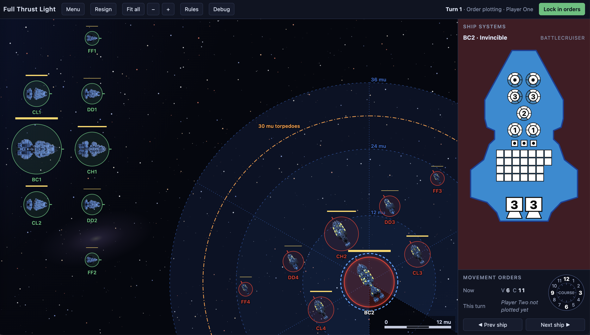

# Full Thrust Light

A browser game of turn-based tactical starship combat, based on the free
*Full Thrust Light* miniatures rules by Ground Zero Games. The **Rules**
button in the toolbar opens the [published PDF](https://downloads.groundzerogames.co.uk/FT0916_UK.pdf).





How to play, and notes on the code, are in [docs/guide.md](docs/guide.md).

## Tech stack

- **Language:** TypeScript (strict), compiled by TypeScript 7.
- **Build and dev server:** Vite.
- **Tests:** Vitest, running in Node with no browser.
- **Lint and format:** oxlint, with type-aware rules, and Prettier.
- **Runtime libraries:** none. The game is plain browser code:
  - the DOM, built with small `h()` and `svg()` helpers (`src/ui/dom.ts`),
    and native `<dialog>` elements;
  - SVG for the ship systems displays and dice;
  - a 2D `<canvas>` for the map;
  - the Web Audio API for sound, both generated in code and recorded clips
    (Ogg and MP3).
- **Game data:** ship designs and scenarios are JSON files in `public/data/`,
  loaded at run time.
- **Output:** the build is static files with relative paths, so it can be
  served from any web server, including GitHub Pages. There is no back end.
- **PDF tools:** Swift scripts for macOS (`tools/extract-art/`) for reading
  the rules PDF, such as the weapon arcs.

## Requirements

- Node.js 20 or later (developed on Node 26)

## Build

```sh
npm install
npm run build
```

The built site is written to `dist/` as static files that work from any web
server, including GitHub Pages; see [docs/guide.md](docs/guide.md#deploying)
for serving and deploying it.

## Run

```sh
npm install
npm run dev
```

Then open the address Vite prints (normally http://localhost:5173).

## Test

```sh
npm test
npm run lint
```

## Credits

- **Jon Tuffley**, designer of *Full Thrust*
- My miniatures photographed for the ships on the map came from **[Ground Zero Games](https://www.gzg.com)**: 
  - the green fleet are from the *FSE – Federal States Europa* range, painted by **Andy Graves**
  - the red fleet are from the *ScanFed – Scandinavian Federation* range, painted by **Alex Redshaw** 
- **[Kenney](https://www.kenney.nl)** for the sound effects, released under [CC0 1.0](https://creativecommons.org/publicdomain/zero/1.0/): [*Sci-Fi Sounds*](https://www.kenney.nl/assets/sci-fi-sounds) in 
`public/sounds/kenney/` and the [*Digital SFX Set*](https://opengameart.org/content/63-digital-sound-effects-lasers-phasers-space-etc) in `public/sounds/kenney-digital/`.

## Licences

- The code is licensed under [CC BY-NC-SA 4.0](https://creativecommons.org/licenses/by-nc-sa/4.0/).
- The photos of the ship miniatures in `public/assets/ships/` are also licensed under 
 [CC BY-NC-SA 4.0](https://creativecommons.org/licenses/by-nc-sa/4.0/), 
 with thanks to their painters, Andy Graves and Alex Redshaw (see *Credits*).
- The recorded sound effects, by Kenney, are released under
  [CC0 1.0](https://creativecommons.org/publicdomain/zero/1.0/), in the
  public domain. The other sounds are generated by the code.

## Disclaimer

This is an unofficial fan made project. Full Thrust and Full Thrust Light are © Ground Zero Games and Jon Tuffley.